# HAM10000 Skin Lesion Diagnosis and Age Prediction using VGG16, ResNet50, and Grad-CAM

This repository contains a PyTorch-based computer vision project using the **Skin Cancer MNIST: HAM10000** dataset. The project performs both **classification** and **regression** on the same image dataset using **VGG16** and **ResNet50** backbones.

The project also includes **Grad-CAM visualizations** to interpret which regions of the dermatoscopic images influenced the model predictions.

---

## Project Overview

This project has two main tasks:

### Task A: Skin Lesion Diagnosis Classification

The classification task predicts the skin lesion diagnosis class from a dermatoscopic image.

The diagnosis classes used in this project are:

```text
akiec, bcc, bkl, df, mel, nv, vasc
```

### Task B: Patient Age Regression

The regression task predicts the patient's age from the same dermatoscopic image.

Age is used as a continuous numeric target for the regression task.

---

## Dataset

Dataset used:

**Skin Cancer MNIST: HAM10000**

Kaggle dataset:

```text
https://www.kaggle.com/datasets/kmader/skin-cancer-mnist-ham10000
```

The HAM10000 dataset contains dermatoscopic images of skin lesions with metadata such as:

- image ID
- lesion diagnosis
- patient age
- patient sex
- lesion localization

In this project, a stratified subset of **5,000 images** was used to keep training practical on Kaggle GPU.

---

## Dataset Split

The selected 5,000 images were split into:

| Split      | Number of Images |
| ---------- | ---------------: |
| Training   |            3,500 |
| Validation |              750 |
| Testing    |              750 |

The split was stratified by diagnosis class so that the class distribution was preserved as much as possible.

---

## Class Distribution in the 5,000-Image Subset

| Class | Number of Images |
| ----- | ---------------: |
| nv    |             3344 |
| mel   |              558 |
| bkl   |              547 |
| bcc   |              258 |
| akiec |              164 |
| vasc  |               71 |
| df    |               58 |

The dataset is imbalanced, with the `nv` class having the highest number of samples.

---

## Models Used

Four models were trained:

| Model    | Task                       |
| -------- | -------------------------- |
| VGG16    | Skin lesion classification |
| VGG16    | Patient age regression     |
| ResNet50 | Skin lesion classification |
| ResNet50 | Patient age regression     |

Both models used ImageNet pretrained weights for transfer learning.

---

## Model Architecture

### VGG16

The VGG16 model was modified as follows:

```text
VGG16 feature extractor
→ Adaptive Average Pooling
→ Flatten
→ Dropout
→ Linear output layer
```

### ResNet50

The ResNet50 model was modified as follows:

```text
ResNet50 backbone
→ Dropout
→ Linear output layer
```

For classification, the output layer predicts 7 lesion classes.

For regression, the output layer predicts 1 continuous value: patient age.

---

## Training Configuration

The main training settings were:

```python
IMG_SIZE = 224
SUBSET_SIZE = 5000
BATCH_SIZE = 16
EPOCHS_HEAD = 20
EPOCHS_FINE_TUNE = 5
USE_PRETRAINED = True
```

Training was done in two stages.

### Stage 1: Train the New Head

The pretrained backbone was frozen, and only the newly added classification or regression head was trained.

Learning rate:

```python
1e-4
```

### Stage 2: Fine-tuning

The final convolutional block was unfrozen and fine-tuned using a smaller learning rate.

Learning rate:

```python
1e-5
```

For VGG16, the last convolutional block was fine-tuned.

For ResNet50, `layer4` was fine-tuned.

---

## Data Augmentation

The following augmentations were applied to the training images:

- resize to 224 × 224
- random horizontal flip
- random vertical flip
- color jitter
- ImageNet normalization

Validation and test images were resized and normalized but not augmented.

---

## Evaluation Metrics

### Classification Metrics

The classification models were evaluated using:

- accuracy
- weighted F1-score
- confusion matrix
- classification report

### Regression Metrics

The regression models were evaluated using:

- mean squared error
- mean absolute error
- root mean squared error
- R² score

---

## Final Results

| Model    | Task           | Accuracy | Weighted F1 Score |      MSE |     MAE |    RMSE |     R² |
| -------- | -------------- | -------: | ----------------: | -------: | ------: | ------: | -----: |
| VGG16    | Classification |   0.7613 |            0.7332 |      N/A |     N/A |     N/A |    N/A |
| VGG16    | Regression     |      N/A |               N/A | 177.9316 | 10.5679 | 13.3391 | 0.3678 |
| ResNet50 | Classification |   0.7627 |            0.7352 |      N/A |     N/A |     N/A |    N/A |
| ResNet50 | Regression     |      N/A |               N/A | 188.3336 | 10.9070 | 13.7235 | 0.3308 |

---

## Result Visualizations

### Sample Dataset Images

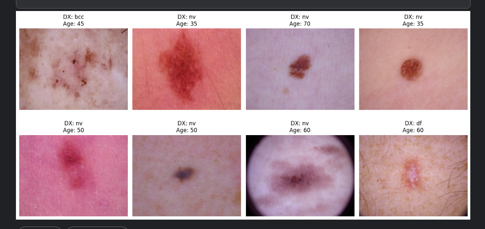

---

## Training Curves

### VGG16 Classification Accuracy

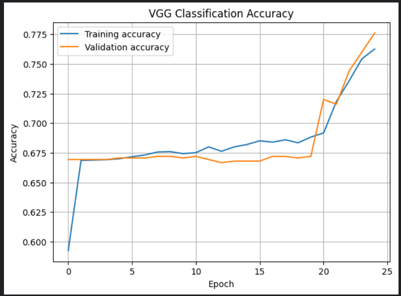

### VGG16 Classification Loss

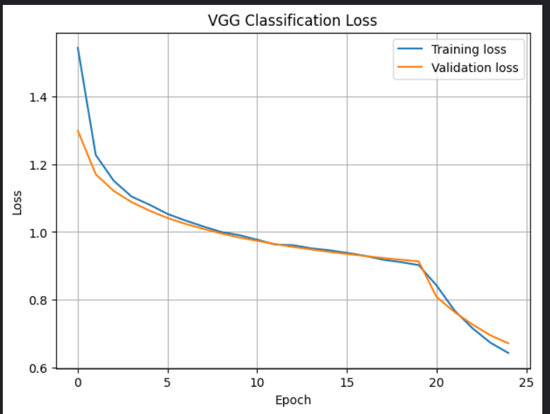

### ResNet50 Classification Accuracy

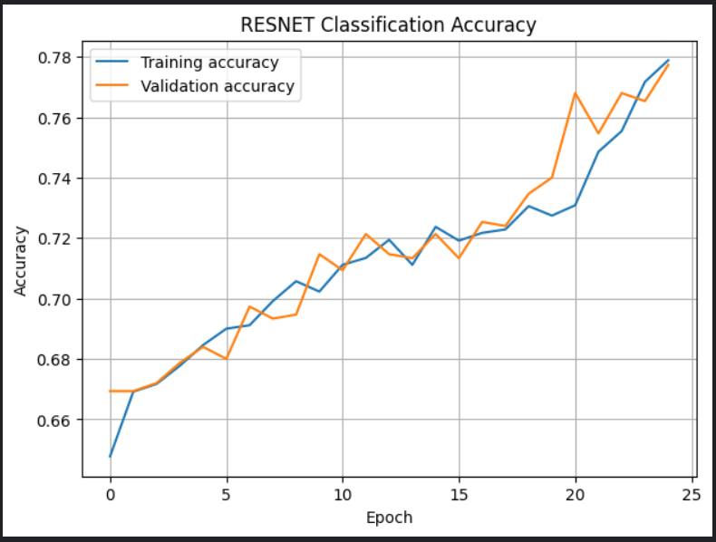

### ResNet50 Classification Loss

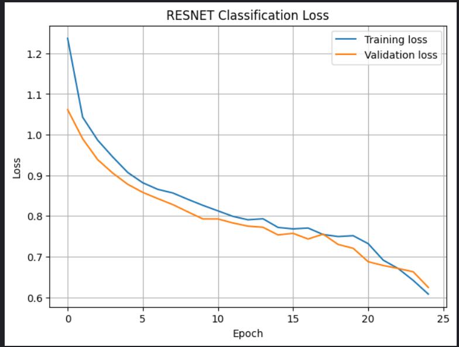

---

## Regression Loss Curves

### VGG16 Regression Loss

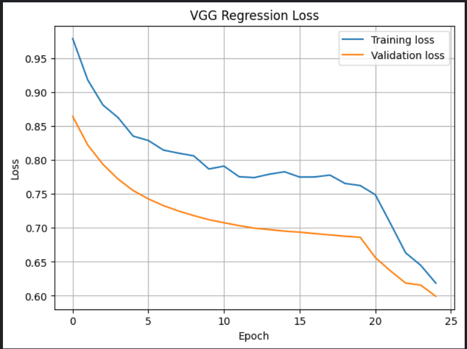

### ResNet50 Regression Loss

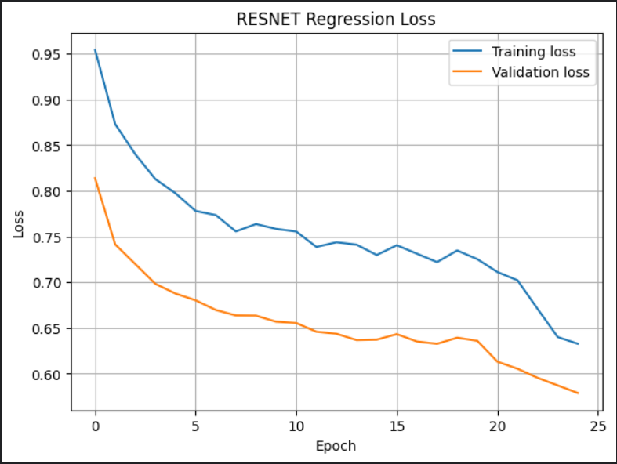

---

## Confusion Matrices

### VGG16 Confusion Matrix

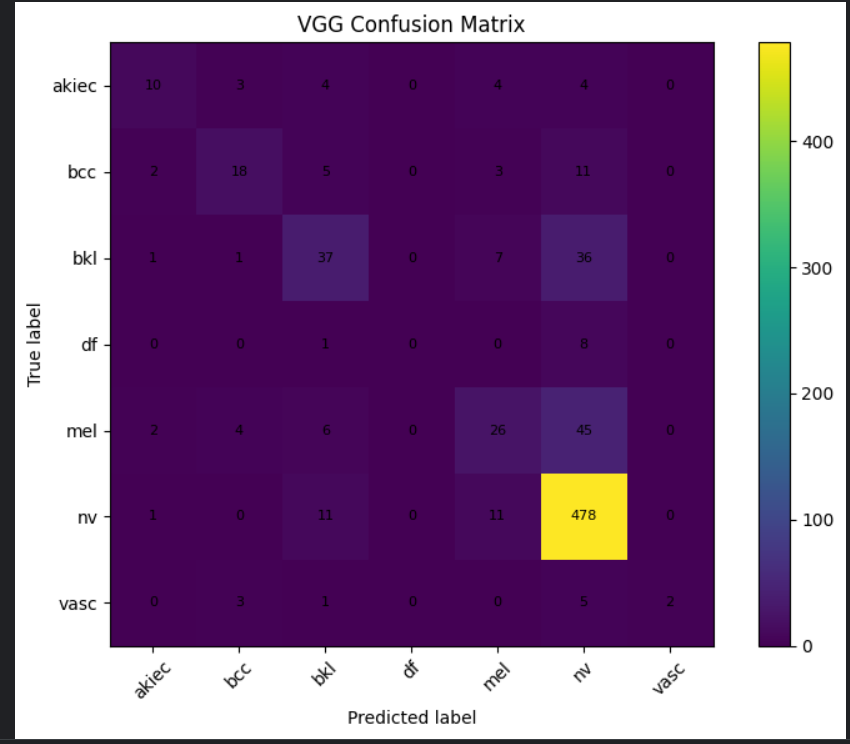

### ResNet50 Confusion Matrix

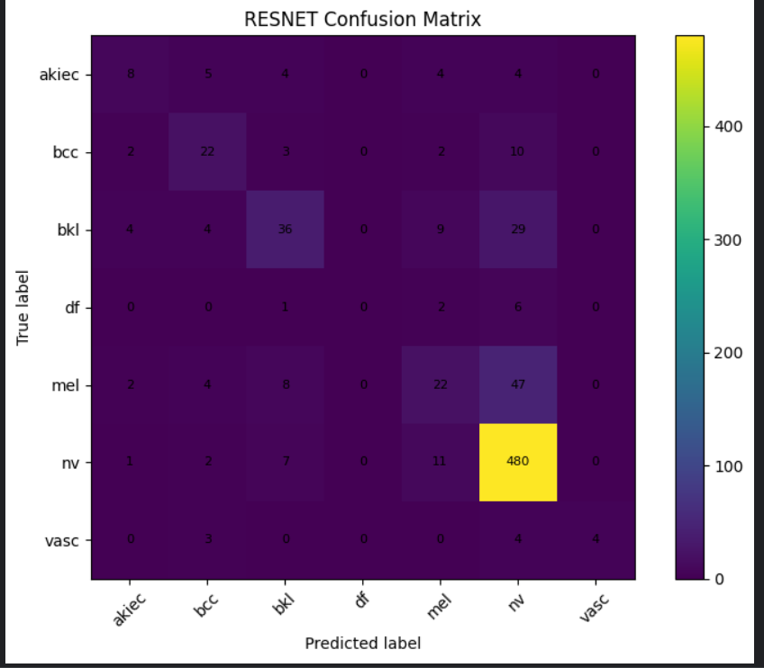

---

## Grad-CAM Visualizations

### VGG16 Grad-CAM

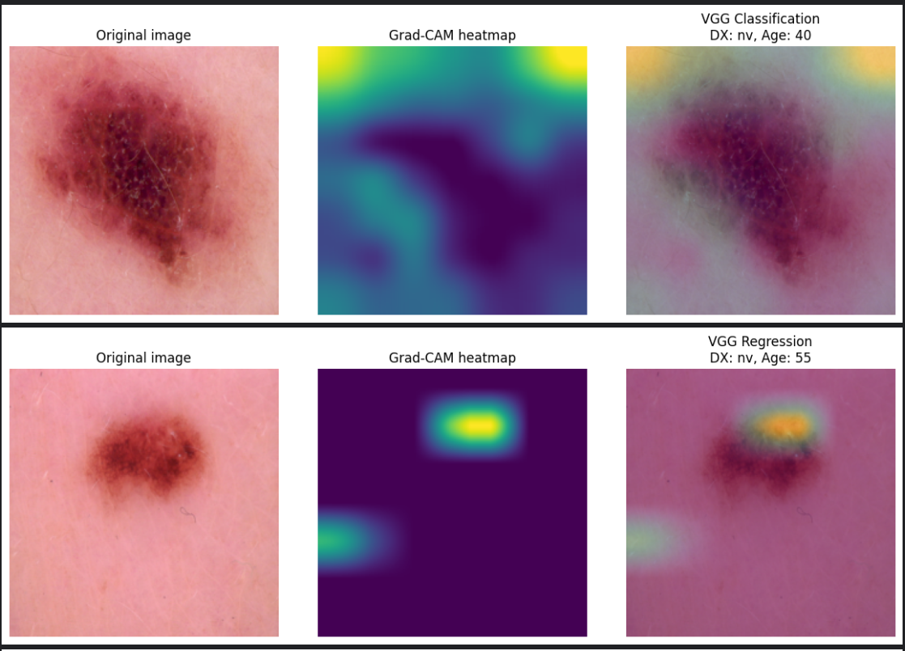

### ResNet50 Grad-CAM

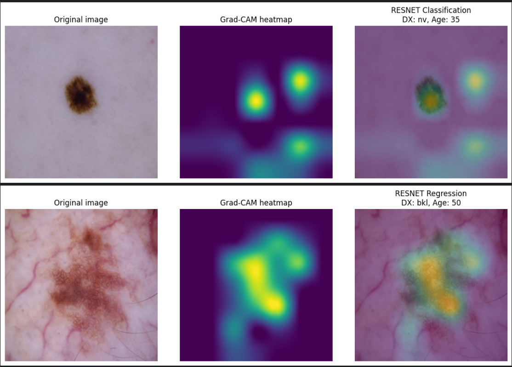

## Result Analysis

For classification, ResNet50 achieved slightly better performance than VGG16.

| Model    | Accuracy | Weighted F1 Score |
| -------- | -------: | ----------------: |
| VGG16    |   0.7613 |            0.7332 |
| ResNet50 |   0.7627 |            0.7352 |

The confusion matrices show that the models perform best on the `nv` class. This is expected because `nv` has the highest number of images in the dataset.

Minority classes such as `df`, `vasc`, and `akiec` are more difficult to classify because they have fewer training samples.

For regression, VGG16 performed slightly better than ResNet50.

| Model    |     MAE |    RMSE |     R² |
| -------- | ------: | ------: | -----: |
| VGG16    | 10.5679 | 13.3391 | 0.3678 |
| ResNet50 | 10.9070 | 13.7235 | 0.3308 |

The age regression task is more challenging than lesion classification because patient age may not be strongly visible from the lesion image alone.

---

## Grad-CAM Explainability

Grad-CAM was used to visualize important image regions for all four trained models:

- VGG16 classification
- VGG16 regression
- ResNet50 classification
- ResNet50 regression

For classification, Grad-CAM highlights regions that influenced the predicted lesion class.

For regression, Grad-CAM highlights regions that influenced the predicted age value.

Grad-CAM makes the model predictions more interpretable by showing whether the model focuses on the lesion area or other surrounding regions.

---

## Repository Structure

```text
.
├── README.md
├── ham10000-skin-cancer-project-in-pytorch.ipynb
├── outputs/
│   ├── final_comparison_table.csv
│   ├── report_summary.txt
│   ├── vgg_classification_best.pth
│   ├── vgg_regression_best.pth
│   ├── resnet_classification_best.pth
│   └── resnet_regression_best.pth
└── figures/
    ├── sample_images.png
    ├── training_curves.png
    ├── confusion_matrices.png
    └── gradcam_examples.png
```

---

## How to Run on Kaggle

1. Open Kaggle.
2. Create a new notebook.
3. Add the dataset:

```text
kmader/skin-cancer-mnist-ham10000
```

4. Turn on GPU:

```text
Settings → Accelerator → GPU T4
```

5. Turn on internet if using pretrained weights:

```text
Settings → Turn on internet
```

6. Run the notebook from top to bottom.

---

## Main Libraries Used

```text
torch
torchvision
numpy
pandas
matplotlib
scikit-learn
PIL
```

---

## Limitations

- The dataset is highly imbalanced, especially because the `nv` class has many more samples than the other classes.
- Minority classes such as `df`, `vasc`, and `akiec` are harder to classify.
- Patient age regression is difficult because age may not be visually clear from the lesion image alone.
- The project uses a 5,000-image subset instead of the full dataset to reduce training time on Kaggle.

---

## Future Improvemesnts

Possible improvements include:

- using the full HAM10000 dataset
- applying class-weighted loss for imbalanced classification
- using stronger augmentation
- trying focal loss for minority classes
- training a multi-task model with both classification and regression heads
- comparing additional interpretability methods such as Grad-CAM++ or Score-CAM

---

Computer Vision and Pattern Recognition Course Project
